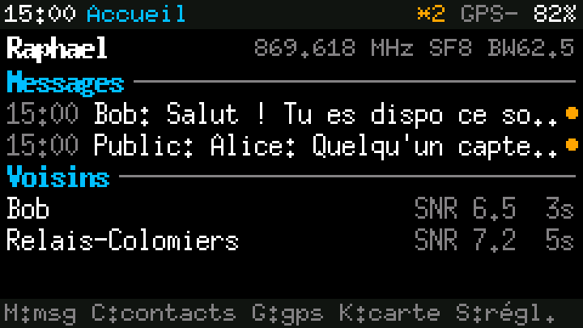
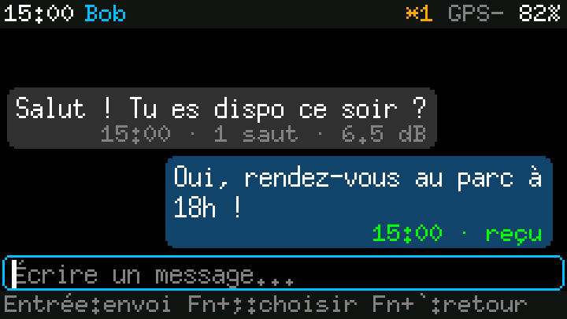
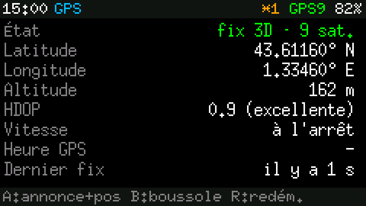
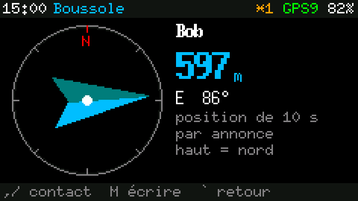
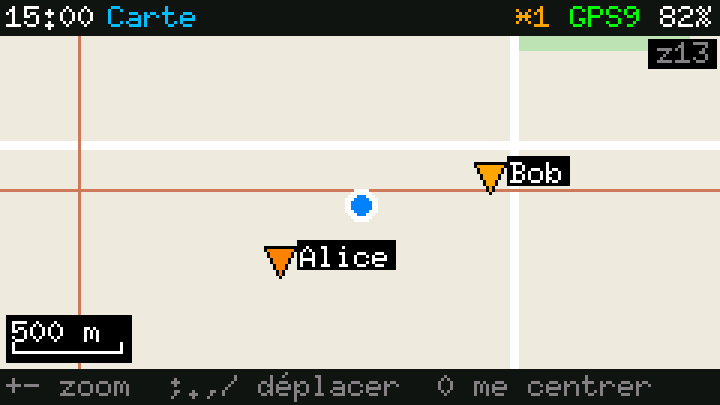
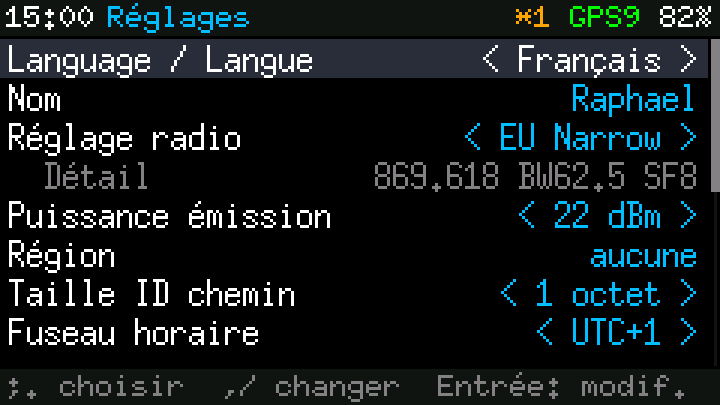

# MeshCore pour le M5Stack Cardputer ADV

[](README.md)
[](README.fr.md)

Un firmware [MeshCore](https://github.com/meshcore-dev/MeshCore) autonome pour le M5Stack Cardputer ADV
équipé du Cap LoRa-1262. Votre Cardputer devient une messagerie maillée à part entière : vous écrivez et
lisez vos messages sur son propre clavier et son écran, vous consultez votre position grâce au GPS
intégré, vous retrouvez vos contacts à la boussole et vous parcourez des cartes hors ligne enregistrées
sur une carte microSD, le tout sans téléphone.

Si vous préférez l'application MeshCore officielle, la même image contient aussi le firmware companion
d'origine. Passer en « mode téléphone » ne demande qu'une entrée de menu, et trois appuis sur **esc**
vous ramènent au mode clavier. Les deux modes partagent la même identité radio : pour le reste du réseau,
il s'agit d'un seul et même nœud.

L'interface est en anglais par défaut ; le français se choisit en un réglage
(*Settings → Language / Langue*).

<table>
<tr><td align="center" width="33%"><br><sub>Accueil : derniers messages et voisins</sub></td><td align="center" width="33%"><br><sub>Conversation avec accusés de réception</sub></td><td align="center" width="33%"><br><sub>État du GPS</sub></td></tr>
<tr><td align="center" width="33%"><br><sub>Boussole pointant vers un contact</sub></td><td align="center" width="33%"><br><sub>Carte hors ligne avec les contacts</sub></td><td align="center" width="33%"><br><sub>Réglages, avec le choix de la langue</sub></td></tr>
</table>

<sub>Captures du simulateur PC (`make -C app/sim readme-images`), qui exécute le même code d'interface que l'appareil. La carte utilise des tuiles de test synthétiques.</sub>

## Ce qu'il vous faut

- un **M5Stack Cardputer ADV** (le Cardputer de première génération n'est pas encore pris en charge) ;
- le **Cap LoRa-1262**, antenne vissée *avant* la mise sous tension : émettre sans antenne peut
  endommager la radio ;
- en option, une **carte microSD** (FAT32) pour les sauvegardes et les cartes hors ligne.

Pas de Cap sous la main ? La version `cardputer_adv_demo` fait tourner toute l'interface seule, avec des
contacts simulés qui vous répondent et une promenade GPS simulée.

## Installation

Des images prêtes à flasher sont jointes à chaque [version publiée](../../releases). Chaque fichier est
une image complète, à écrire à l'adresse `0x0` :

| Fichier | Contenu |
| --- | --- |
| `cardputer_adv_dual` | **recommandé** : messagerie au clavier avec cartes hors ligne, plus le mode téléphone |
| `cardputer_adv_standalone` | messagerie au clavier seule |
| `cardputer_adv_standalone_map` | messagerie au clavier avec cartes hors ligne |
| `cardputer_adv_companion_ble` | mode téléphone seul (companion MeshCore officiel) |
| `cardputer_adv_demo` | démo sans le Cap LoRa |

Le plus simple est de passer par un outil de flash dans le navigateur, comme
[ESPConnect](https://thelastoutpostworkshop.github.io/ESPConnect/). En ligne de commande :

```bash
esptool.py --chip esp32s3 write_flash 0x0 cardputer_adv_dual.bin
```

Les images autonome, carte et démo sont aussi prévues pour M5Launcher, qui leur attribue toute la mémoire
flash libre pour l'historique des messages. Un guide détaillé, pas à pas, se trouve dans
[`app/FLASH.md`](app/FLASH.md).

## Compiler depuis les sources

Le projet utilise [PlatformIO](https://platformio.org/). MeshCore y est intégré sous forme de sous-module
git : pensez donc à cloner de façon récursive.

```bash
git clone --recursive <adresse-du-dépôt>
cd <dépôt>
pio run -e cardputer_adv_dual_standalone -e cardputer_adv_dual_companion
python3 tools/make_dual.py          # produit .pio/build/firmware-dual.bin
```

Flashez l'image puis ouvrez le moniteur série :

```bash
pio pkg exec -p tool-esptoolpy -- esptool.py --chip esp32s3 -b 921600 write_flash 0x0 .pio/build/firmware-dual.bin
pio device monitor -b 115200
```

Le journal série est pensé pour faciliter le diagnostic sur le terrain : le journal de démarrage est
réaffiché dès qu'un moniteur se connecte, une ligne d'état résume la situation toutes les dix secondes,
et le firmware autonome propose une petite console. Tapez `help` pour lister ses commandes (événements
bruts du clavier, trames GPS brutes, scan du bus I2C, etc.).

Si vous avez oublié `--recursive`, lancez `git submodule update --init` avant de compiler.

## Tester sans matériel

L'essentiel du code peut être éprouvé sur une machine Linux ordinaire :

```bash
make -C app/sim -j8 test run
```

`test` fait tourner les pilotes du clavier, du GPS et de l'extenseur d'E/S face à des modèles logiciels
des vraies puces, y compris dans les cas délicats : un GPS qui parle à une vitesse inattendue, un
contrôleur de clavier qui perd sa configuration après une micro-coupure, une file d'événements saturée.
`run` rejoue des sessions d'utilisation scriptées sur la véritable interface et enregistre des captures
d'écran dans `app/sim/build/`. Chaque session est jouée deux fois : une fois avec des touches injectées
directement, une fois en faisant passer chaque appui par le contrôleur de clavier émulé.

La radio, le codec audio et la batterie ne sont pas émulés : il faut toujours un véritable appareil pour
les valider.

## Organisation du projet

```
meshcore/            MeshCore officiel, en sous-module git figé sur une version publiée
meshcore_base.ini    réglages de compilation communs de MeshCore (généré, ne pas modifier)
platformio.ini       les variantes de firmware que nous compilons
variant/             support de la carte : écran, journal série, bascule de mode, tables de partitions
app/                 l'interface clavier, les pilotes portables et le simulateur PC
boards/              définition de la carte pour PlatformIO
tools/               assemblage de l'image double, conversion des cartes, mise à jour de MeshCore, feuille de route
docs/                feuille de route et captures du README
```

Aucune ligne de notre code ne se trouve dans MeshCore, et MeshCore lui-même n'est jamais modifié. Les
mises à jour restent donc peu coûteuses : passer à une nouvelle version de MeshCore revient à faire
pointer le sous-module vers une autre étiquette.

## Suivre les versions de MeshCore

Les versions officielles de MeshCore sont publiées sous forme d'étiquettes `companion-vX.Y.Z` ; leur
branche `main` suit ces versions, tandis que le développement courant se fait sur `dev`. Ce projet ne
suit que les versions publiées.

Pour mettre à jour à la main :

```bash
python3 tools/update_meshcore.py --dry-run   # quelle version, et lesquelles de nos dépendances ont changé
python3 tools/update_meshcore.py             # passer à la dernière version (ou indiquer une étiquette précise)
```

Recompilez ensuite tous les environnements, lancez le simulateur, testez sur un appareil, puis commitez
`meshcore` avec `meshcore_base.ini`.

Un workflow GitHub planifié, *MeshCore update*, fait tout cela chaque lundi. Lorsqu'une nouvelle version
sort, il prépare la mise à jour sur une branche à part et lance l'ensemble des vérifications : chaque
firmware doit compiler, respecter le budget mémoire et tenir dans sa partition flash, et chaque test de
pilote comme chaque scénario d'interface doit passer. Au moindre échec, `main` reste intact. Si tout
passe, il ouvre une pull request pour que vous puissiez flasher le résultat et l'essayer avant de
fusionner ; si vous avez réglé la variable de dépôt `MESHCORE_AUTO_MERGE` sur `true`, il fusionne
directement (jamais lors d'un changement de version majeure).

Pour que le workflow puisse pousser des branches et ouvrir des pull requests, activez *Read and write
permissions* et *Allow GitHub Actions to create and approve pull requests* dans
*Settings → Actions → General*.

## Cartes hors ligne

Les cartes sont stockées sur la microSD sous forme de tuiles brutes que le Cardputer affiche sans
décodage. Le convertisseur de `tools/tiles/` les fabrique à partir d'un fichier MBTiles (exporté depuis
QGIS, par exemple) ou d'un serveur de tuiles dont les conditions autorisent l'usage hors ligne, ce qui
n'est pas le cas des serveurs publics d'OpenStreetMap. Voir [`tools/tiles/README.md`](tools/tiles/README.md).

## Feuille de route

La suite du projet, avec une priorité et une taille estimée pour chaque élément, se trouve dans
[`docs/ROADMAP.md`](docs/ROADMAP.md) (en anglais) : recherche de signal, tests de portée, synchronisation entre
le mode téléphone et le mode clavier, économies d'énergie, etc. Chaque version publiée liste aussi les
éléments terminés depuis la précédente.

## Remerciements

Construit sur [MeshCore](https://github.com/meshcore-dev/MeshCore), par l'équipe meshcore-dev, et sur
les bibliothèques M5Unified et M5GFX de M5Stack. La disposition du clavier reprend celle de la
bibliothèque M5Cardputer de M5Stack.
